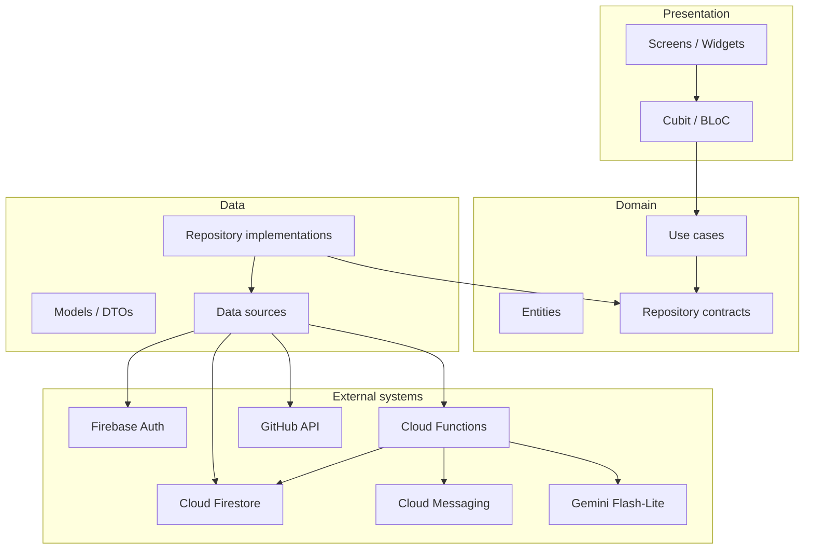

<p align="center">
  
</p>

<p align="center">
  
</p>

<h1 align="center">DevSync</h1>

<p align="center"><strong>AI-Powered Developer Collaboration Platform</strong></p>

<p align="center"><em>Code with the right people.</em></p>

<p align="center">
  
  
  
  
  
</p>

DevSync helps a developer find an open-source project that actually fits them, and helps a maintainer find a contributor who can help — then they connect inside the app. The story below is the overall scenario.

| | |
|---|---|
| **Project** | DevSync: Secure AI Project Collaborator |
| **Type** | Flutter graduation project · team of 5 |
| **Timeline** | 16 October 2026 – 30 November 2026 |
| **Primary platform** | Android (Free and Pro flavors planned) |
| **Backend** | Firebase Auth + Firestore (FCM, Cloud Functions, Gemini matching planned) |
| **Methodology** | Agile Scrum (Jira + GitHub pull requests) |

> **Built now:** design system, Lucide icons, brand assets, auth screens, Firebase Auth, and `users/{uid}` identity. **Not built:** Profile, Projects, Match Feed, like/skip, Requests, FCM, Cloud Functions, live Gemini. See [§14 Built so far](#14-built-so-far-for-the-team). Screen-by-screen flow: [docs/APP_FLOW.md](docs/APP_FLOW.md).

---

## Table of contents

1. [Overview and overall scenario](#1-overview-and-overall-scenario)
2. [Project objectives](#2-project-objectives)
3. [Core features](#3-core-features)
4. [Technology stack](#4-technology-stack)
5. [System architecture](#5-system-architecture)
6. [Project team](#6-project-team)
7. [Timeline and methodology](#7-timeline-and-methodology)
8. [Repository structure](#8-repository-structure)
9. [Getting started](#9-getting-started)
10. [Git branching and contribution workflow](#10-git-branching-and-contribution-workflow)
11. [Documentation](#11-documentation)
12. [Security considerations](#12-security-considerations)
13. [Project status and roadmap](#13-project-status-and-roadmap)
14. [Built so far (for the team)](#14-built-so-far-for-the-team)

---

## 1. Overview and overall scenario

Nour wants to contribute to open source. She does not know which repo actually needs Dart and Flutter animation. Karim maintains `flutter-oss/charts` and needs those skills. They never meet on GitHub search. DevSync is the story of how they find each other.

**Karim (maintainer)** opens DevSync, signs in, and adds his project: title, short description, GitHub link, and skills needed (Dart, Firebase, Animation). The project is now something the app can match on. DevSync does not host the code; it only links to GitHub.

**Nour (contributor)** opens the same app, creates an account, connects GitHub (sample data is enough at first), and taps her skills. The feed then compares **her skills and public GitHub activity** with **Karim’s needed skills**. She sees a card: project name, a fit score, a one-line reason (*“You shipped Dart and Firebase.”*), and the overlapping skills. If scoring is slow or she is offline, the app still ranks by skill overlap. If she has no skills yet, the feed is empty until she adds them.

She can **skip** a card that is a poor fit, **like** one that looks right, or open **project detail**. On Karim’s project she writes a short note and **requests to collaborate** (one request per project). Karim sees it, reads her profile and message, and **accepts** or **declines**. If he accepts, they are **connected**. They then work on GitHub — not in an in-app chat (chat is out of scope).

The same signed-in person can be both contributor and maintainer.

```text
Sign in → Profile (skills + GitHub) → Projects exist
       → Match feed (score + reason) → Like / skip or open detail
       → Request to join → Maintainer accepts → Connected
```

### Problem

Open-source discovery is mostly tags and stars. Contributors waste time on repos that do not fit. Maintainers cannot see who has actually shipped the skills they need.

### Solution

A mobile matching path with a scored, explained feed and a built-in request — not another project search page. Course delivery is an Android install link, not an app-store product. Full screen list: [docs/APP_FLOW.md](docs/APP_FLOW.md). Prototype: [docs/index.html](docs/index.html).

---

## 2. Project objectives

| Objective | Description |
|---|---|
| Working matching app | Deliver a working Android app with AI-driven developer-to-project matching |
| Secure authentication | Sign-in with Google and email/password via Firebase Authentication |
| Real-time collaboration | Collaboration requests with FCM alerts for requests and status updates |
| Modern UX | Smooth UI following the DevSync design system, with Flutter animations |
| Release hygiene | Obfuscated Free and Pro release builds, plus an Android App Bundle (`.aab`) |
| Team learning | Every member gains hands-on experience across UI, logic, Firestore, and tests |
| Documentation | Full technical documentation, this README, clean Git history, and a security-reviewed app |

Scope is split into **must-have** (protected through the core freeze) and **if time allows** items. Out of scope for this delivery: iOS release, app-store publishing, in-app payments, and hosting project source code inside DevSync (the app links to GitHub).

---

## 3. Core features

Feature ownership follows [DevSync-Feature-Summaries-All-Members.pdf](docs/DevSync-Feature-Summaries-All-Members.pdf): **one owner builds UI, logic, Firestore, tests, and docs** for each feature. Reviewers are listed in that document.

### Must-have (planned for core freeze — 12 November 2026)

| Area | Owner | Due | Features |
|---|---|---|---|
| Foundation | Donia | W1 · 22 Oct | Repo (`main`/`develop`), Firebase, Firestore collections, Jira Sprint 1, README collection map |
| Design system | Donia | Done | Theme, shared widgets, animation kit, wireframes; 48 dp targets, 4.5:1 contrast |
| App shell + CI | Yousef | W1 · 22 Oct | Structure, navigation stubs, Free/Pro flavors, Firebase per flavor, CI + sample widget test |
| Authentication | Donia | W2 · 29 Oct | Welcome/login/register/reset; Google + email; session persistence; user doc + FCM token; account deletion |
| Profile & GitHub | Saga | W2 · 29 Oct | Skills/bio; public GitHub stats (languages, repos, contributions); cache/refresh; sample JSON first |
| Projects | Bishay | W2 · 29 Oct | List/detail; add/edit (title, description, GitHub link, needed skills); seed data; maintainer-only edits |
| AI matching + feed | Emad | v1 29 Oct · tuned 12 Nov | Ranked feed, score + reason; Cloud Function (LLM secret); cache; skills fallback; call limits |
| Like / skip | Yousef | W2 · 29 Oct | Feedback per user/project in Firestore for prompt evaluation |
| Requests + FCM | Yousef | 5 Nov | One request per project + message; accept/decline; FCM on new/status change; permission at use |
| Key animations | Bishay | 5 Nov | Transitions on sign-in, feed, requests, profile (via owner-reviewed PRs) |
| Security rules | Donia | 12 Nov | Firestore rules + unit tests; secrets scan; permission UX; security checklist items |
| Release + reports | Saga | 12 Nov / 30 Nov | Obfuscated builds, `.aab`, install link, test & security report, README assembly |

### If time allows (after core freeze — feature freeze 26 November 2026)

| Feature | Owner | Notes |
|---|---|---|
| Task management board | Donia | Create/assign/move tasks; start only after 12 Nov |
| Task-related FCM alerts | Yousef | Reuse request FCM pattern |
| Prompt-quality dashboard | Emad | Relevance per prompt version; pilot support |
| Extra animations + usability walkthrough | Bishay | Sign in → matches in under 2 minutes |
| Regression + Pro-only extras | Saga | Full regression; Pro flavor extras |

### Intentionally out of scope / future

See [Project status and roadmap](#13-project-status-and-roadmap) for post–30 November ideas (web platform, iOS, issue-level matching, in-app chat, paid Pro, and more).

---

## 4. Technology stack

| Layer | Technology | Role |
|---|---|---|
| Mobile app | Flutter & Dart | Cross-platform UI (Android focus for this delivery) |
| Icons | [lucide_icons_flutter](https://pub.dev/packages/lucide_icons_flutter) | Global Lucide icon set via `AppIcons` / `DsIcon` (matches prototype) |
| Fonts | google_fonts | Bricolage Grotesque (headings) + Figtree (body / UI) |
| Auth | Firebase Authentication | Email/password implemented; Google and GitHub buttons coded (Console / SHA-1 still needed) |
| Database | Cloud Firestore | Users, projects, matches cache, requests, feedback |
| Notifications | Firebase Cloud Messaging (FCM) | Push alerts for collaboration and updates |
| Backend logic | Firebase Cloud Functions | FCM triggers; secure LLM API calls (keys never in the app) |
| Developer data | GitHub API | Public profiles, repositories, and activity |
| AI matching | Gemini Flash-Lite (via Cloud Function) | Fit scores and short explanations; prompt versioning; evaluate one hosted open-source model (Llama / Qwen / gpt-oss) on the eval set |
| State | flutter_bloc (Cubit first) | Presentation state; screens render Cubit states |
| DI | get_it | Composition root in `lib/core/di/injection.dart` |
| Errors | `Result<T>` + typed `Failure` | Mapped at the repository boundary |
| Version control | Git & GitHub | Branches, pull requests, optional Releases for install builds |
| Project management | Jira | Scrum board, sprints, task tracking |
| Design | DevSync brand system | Teal / forest palette; shared `Ds*` widgets in `lib/core/` |

**Firestore:** `users/{uid}` identity is implemented. Planned: `projects`, `matches`, `feedback`, `requests`. If-time: `tasks`.

<p align="center">
  
  &nbsp;&nbsp;
  
  &nbsp;&nbsp;
  
  &nbsp;&nbsp;
  
</p>

---

## 5. System architecture

The app uses **feature-first Clean Architecture** (BLoC/Cubit + GetIt + Firebase). Domain does not import Flutter, Firebase, or GetIt. Auth is the template; copy `lib/features/auth/` for features that talk to Firestore. Full rules: [docs/ARCHITECTURE.md](docs/ARCHITECTURE.md).



**Sign-in (implemented):** Login form → `LoginCubit` → `SignInWithEmail` → `AuthRepository` → Firebase Auth + `users/{uid}` → `Result` → Cubit emits success / verify-email / failure → UI navigates or shows a snackbar.

Dio is **not** in the stack. If a Cloud Function later needs a shared HTTP client, add one Dio instance in `core/` and keep it behind a data source.

### Matching flow (planned)

1. Collect GitHub activity and declared skills into a structured profile
2. Send the profile and candidate projects to a Cloud Function with a versioned matching prompt
3. **Gemini Flash-Lite** (primary) returns a **fit score** and a **short reason** per project (target: ≤ 5 s for 95% of calls)
4. The app shows a ranked feed; users **like** or **skip**
5. Feedback and an evaluation set are used to compare prompt versions and keep the better one
6. If the model fails or is slow, a **skills-based fallback** still fills the feed

Input/output JSON for the matcher is frozen early (W1 sample data) so the feed, like/skip, and evaluation work can proceed in parallel.

---

## 6. Project team

Everyone owns full feature slices (UI + logic + Firestore + tests + docs) and reviews each other’s work. Coordination titles below match [DevSync-Feature-Summaries-All-Members.pdf](docs/DevSync-Feature-Summaries-All-Members.pdf).

| Member | Role | Load | Backup | GitHub | Email |
|---|---|---|---|---|---|
| Donia Alhosin | Project Manager — accounts, data backbone, security rules | 12 pts (+ PM) | Yousef | — | — |
| Bishay Talaat | Design & Brand Lead — projects, animations, presentation | 7 pts | Emad | — | [bishayezat9@gmail.com](mailto:bishayezat9@gmail.com) |
| Yousef Mohy | App Architecture Lead — shell, requests + FCM, CI, like/skip | 10 pts | Saga | — | [moheyy28@gmail.com](mailto:moheyy28@gmail.com) |
| Emad Hany | AI & Prompt Lead — matching, feed, prompt evaluation | 8 pts | Donia | [@3madhani](https://github.com/3madhani) | — |
| Saga Maher | Quality, Security & Release Lead — profile/GitHub, builds, reports | 10 pts | Bishay | — | [sagamaher2002@gmail.com](mailto:sagamaher2002@gmail.com) |

### Feature ownership (summary)

| Member | Core features | If time |
|---|---|---|
| **Donia** | Foundation; design system (done); authentication; security rules | Task board |
| **Bishay** | Projects (seed + add/edit); key-screen animations; final presentation + demo | Extra animations + usability walkthrough |
| **Yousef** | App shell + flavors; CI/tests setup; collaboration requests + FCM; like/skip | Task FCM alerts |
| **Emad** | AI matching + match feed; prompt evaluation + tuning | Prompt-quality dashboard |
| **Saga** | Profile + GitHub data; obfuscated builds + install link; test/security report + README | Regression + Pro-only extras |

**Backup chain:** Yousef covers Donia; Emad covers Bishay; Saga covers Yousef; Donia covers Emad; Bishay covers Saga.

**PM duties (Donia, on top of feature points):** Monday sprint planning and capacity check, weekly supervisor update, Jira epics, KPI tracking (notification delivery, uptime, adoption, collaboration activity, sprint delivery, milestones).

> Add missing GitHub usernames and emails as team members share them, then update this table.

---

## 7. Timeline and methodology

| | |
|---|---|
| **Implementation window** | 16 October 2026 – 30 November 2026 |
| **Cadence** | Six 1-week sprints + a 6-day final window |
| **Tracking** | Jira Scrum board (To do → In progress → In review → Done), linked to GitHub |

| Period | Milestone |
|---|---|
| W1 · 16–22 Oct | Foundation, app shell, theme/design system, CI; AI skeleton (prompt, Cloud Function, sample JSON) |
| W2 · 23–29 Oct | Auth, profile, projects, AI v1 + feed, like/skip |
| Through 5 Nov | Collaboration requests + FCM end to end; key-screen animations |
| Through 12 Nov | Security rules; prompt evaluation/tuning; first obfuscated build; core tested — **core freeze** |
| 13–26 Nov | Optional features (task board, task alerts, prompt dashboard, extras) or buffer — **feature freeze 26 Nov** |
| 27–30 Nov | Final Free/Pro builds, install link, docs, README, presentation |

**Definition of done:** UI uses the design system; logic and state work; Firestore data and rules in place; tests written and passing; animation on key screens (with Bishay); reviewed by a different person; tested by someone other than the author; docs written in the same pull request.

---

## 8. Repository structure

```text
devsync_open_source_collaboration_app/
├── assets/brand/png/        # App logos & icons (wired in pubspec)
├── android/ ios/ web/ …     # Platform hosts (app name DevSync + brand launcher icon)
├── lib/
│   ├── main.dart
│   ├── bootstrap.dart       # Firebase + GetIt + runApp
│   ├── app/                 # DevSyncApp + named routes
│   ├── core/
│   │   ├── di/              # GetIt composition root
│   │   ├── error/ result/ usecase/
│   │   ├── icons/ theme/ widgets/ constants/
│   └── features/
│       ├── auth/            # data / domain / presentation (template)
│       ├── shell/           # Home nav shell, Settings, stubs
│       ├── matching/ profile/ projects/ requests/ tasks/
├── test/
├── docs/
│   ├── ARCHITECTURE.md      # Clean Architecture standard
│   ├── APP_FLOW.md
│   ├── index.html           # Interactive prototype (v27)
│   └── …planning PDFs & brand logos
├── pubspec.yaml
└── README.md
```

Still planned: Firebase config, Cloud Functions, Free/Pro flavors Gradle, feature backends.

---

## 9. Getting started

### Prerequisites

- [Flutter SDK](https://docs.flutter.dev/get-started/install) (this project targets Dart SDK `^3.12.2`)
- Android Studio or VS Code with Flutter/Dart plugins
- An Android emulator or physical device
- Git

Verify your toolchain:

```bash
flutter doctor
flutter --version
```

### Clone and install dependencies

```bash
git clone <your-repository-url>
cd devsync_open_source_collaboration_app
flutter pub get
```

### Run the app

```bash
flutter run
```

Or pick a device explicitly:

```bash
flutter devices
flutter run -d <device_id>
```

App opens on **Welcome** → Sign in / Get started. Settings, theme, and log out: Home → **Settings**.

### Analyze and test

```bash
dart format --output=none --set-exit-if-changed .
flutter analyze
flutter test
```

### Firebase, GitHub API, and LLM setup

These backends are **required for product features** but are **not fully wired in this repository yet**. When configuring locally:

1. Create or join the team Firebase project
2. Add Android apps for Free and Pro flavors (separate application IDs)
3. Place platform config files as directed by the team (never commit secrets or LLM API keys)
4. Deploy Cloud Functions that hold the LLM API key as a **secret**
5. Configure GitHub API access according to the team’s agreed approach (public data only; respect rate limits)

Exact project IDs, package names, and credentials are shared privately within the team — they are intentionally omitted from this README.

### Flavors and release builds (planned)

Free and Pro flavors (own app ID, icon, and Firebase config) and obfuscated release / App Bundle commands will be documented here once the flavor Gradle setup lands (Yousef: shell/flavors; Saga: signed obfuscated builds + install link). A short install guide will be added to this README with the first release build. Until then, use the default `flutter run` / `flutter build apk` workflow on the scaffold.

**Performance targets (from requirements / feature summaries):** cold start ≤ 3 s (NFR-02); match response ≤ 5 s for 95% (NFR-01); FCM delivery ≤ 10 s for 95% (NFR-03).

---

## 10. Git branching and contribution workflow

Aligned with the Project Planning document:

| Item | Rule |
|---|---|
| Branches | `main` (stable), `develop` (integration), `feature/<name>`, `fix/<name>`, `release/<version>` |
| Pull requests | Every change via PR with **at least one reviewer**; no direct pushes to `main` |
| Commits | Short, clear messages starting with the Jira key (e.g. `DS-12: add match score meter`) |
| Jira link | Jira key in branch names and commits (e.g. `feature/DS-12-match-feed`) |
| Reviews | Author ≠ reviewer; someone other than the author tests before merge |

Suggested flow:

1. Create a Jira-linked branch from `develop`
2. Implement a feature slice (UI + logic + data + tests where applicable)
3. Open a pull request against `develop`
4. Address review feedback; merge when the definition of done is met
5. Integrate to `main` for milestones / releases as agreed by the release lead

---

## 11. Documentation

Course and project documents live under [`docs/`](docs/). Use these as the source of truth for scope and requirements.

| Document | File |
|---|---|
| Project Planning & Management | [DevSync-1-Project-Planning-and-Management.pdf](docs/DevSync-1-Project-Planning-and-Management.pdf) |
| Literature Review | [DevSync-2-Literature-Review.pdf](docs/DevSync-2-Literature-Review.pdf) |
| Requirements Gathering | [DevSync-3-Requirements-Gathering.pdf](docs/DevSync-3-Requirements-Gathering.pdf) |
| Feature Summaries (all members) | [DevSync-Feature-Summaries-All-Members.pdf](docs/DevSync-Feature-Summaries-All-Members.pdf) |
| Clean Architecture standard | [docs/ARCHITECTURE.md](docs/ARCHITECTURE.md) |
| Full app flow (screens + owners) | [docs/APP_FLOW.md](docs/APP_FLOW.md) |
| Interactive prototype + team hub | [docs/index.html](docs/index.html) |
| Brand Guidelines | [DevSync_Brand_Guidelines.pdf](docs/DevSync_Brand_Guidelines.pdf) |
| Brand Guide (HTML) | [DevSync Brand Guide.html](docs/DevSync%20Brand%20Guide.html) |

The **Feature Summaries** PDF is the source of truth for per-member ownership, loads (story points), reviewers, backups, handoffs, and if-time work. Brand tokens and UI patterns also come from the Brand Guide and the prototype.

Brand assets (logos/icons) are under [`docs/devsync-logos/`](docs/devsync-logos/) and copied for the app into [`assets/brand/png/`](assets/brand/png/).

---

## 12. Security considerations

Security is a first-class delivery requirement: **Donia** owns Firestore rules and related checklist items; **Saga** owns the test/security report and release hygiene; the whole team shares responsibility.

| Topic | Approach |
|---|---|
| Authentication | Firebase Auth with secure token handling |
| Data access | Firestore rules so users read/write only their own data and their requests (unit-tested) |
| Secrets | No API keys in the repository; LLM key stays a Cloud Function secret; secrets scan before release |
| Network | HTTPS for all traffic |
| Code protection | Obfuscation on release builds; symbol files stored safely (not in public docs) |
| Permissions | Runtime prompts explained; app must still work if notification permission is denied |
| Privacy | Only public GitHub data and user-declared skills; users can delete their account data |
| Review | Security checklist 100% before release; each FR linked to a test case in Saga’s report |

Do **not** commit `google-services.json` variants that embed private keys beyond normal client config practice, `.env` files, service-account JSON, or LLM credentials.

---

## 13. Project status and roadmap

### Status (as of README authorship)

| Area | Status |
|---|---|
| Project planning & requirements docs | Available in `docs/` |
| Per-member feature summaries | [DevSync-Feature-Summaries-All-Members.pdf](docs/DevSync-Feature-Summaries-All-Members.pdf) |
| Brand guide, logos, prototype | Available in `docs/` (+ `docs/index.html`) |
| Design system (tokens + `Ds*` widgets) | Implemented in `lib/core/` |
| Global Lucide icons (`AppIcons`) | Implemented — use instead of Material `Icons` |
| App name + launcher / favicon | DevSync branding on Android / iOS / web / desktop |
| Auth flow (Intro → Welcome → Login/Register/OTP) | UI + Firebase Auth + `users/{uid}` identity implemented |
| Settings (prototype screen 21) | Implemented — appearance, notification toggles, Free/Pro preview, sign out, delete dialog |
| Google / GitHub sign-in | Coded; enable providers in Firebase Console (SHA-1 for Google) |
| Profile, Projects, Feed, Requests | Planned — owners and due dates in §3 |
| GitHub API / FCM / Cloud Functions / Gemini | Planned — not implemented in-repo yet |
| Remaining product features | Planned (owners and due dates in §3) |
| Install-link release / App Bundle | First obfuscated build by 12 Nov; final 30 Nov 2026 |
| App store deployment | Out of scope for this course delivery |

### Near-term delivery (through 30 November 2026)

1. W1: Foundation, app shell/flavors, theme, CI, AI skeleton
2. W2: Auth, profile, projects, AI v1 feed, like/skip
3. Through 5 Nov: Collaboration requests + FCM; key animations
4. Through 12 Nov: Security rules, prompt tuning, first obfuscated build — **core freeze**
5. Through 26 Nov: Optional features or buffer — **feature freeze**
6. 27–30 Nov: Final builds, install link, docs, presentation

### Future roadmap (after 30 November 2026)

From the planning and requirements documents — **not committed for this delivery**:

- Pilot with 20+ users and deeper match-quality measurement
- Automated prompt evaluation in CI; Remote Config / A/B for prompt versions
- Firebase App Check and stronger abuse protection
- Web platform on the same Firebase backend
- iOS build
- Real Pro plan with in-app payments
- Issue-level matching, skill-gap hints, maintainer search, in-app chat, endorsements
- Localization (e.g. Arabic RTL) and analytics dashboards

---

## 14. Built so far (for the team)

Shared foundation everyone should reuse. Do **not** invent local colors, fonts, or Material `Icons` in feature PRs.

### Design tokens (`lib/core/theme/`)

| Token | Purpose |
|---|---|
| `AppColors` | Teal `#2EE0C8`, Forest `#0E2624`, Mint, Surface, Line, Muted, Danger, … |
| `AppSpacing` | 48 dp min touch, 56 dp buttons, radii matching the prototype |
| `AppTypography` | Bricolage Grotesque + Figtree via `google_fonts` |
| `AppAnimations` | Prototype ease `cubic-bezier(.2,.8,.2,1)` |
| `AppTheme.dark()` | Material 3 theme wired to the tokens |

### Global icons (`lib/core/icons/app_icons.dart`)

Package: **`lucide_icons_flutter`** (same family as the HTML prototype).

```dart
import 'package:devsync_open_source_collaboration_app/core/icons/app_icons.dart';
import 'package:devsync_open_source_collaboration_app/core/widgets/ds_icon.dart';

DsIcon(AppIcons.feed, color: AppColors.teal);
// or pass into buttons:
DsButton(label: 'Next', icon: AppIcons.forward, onPressed: () {});
```

Add new icons **only** on `AppIcons` so the set stays global. Browse names at [lucide.dev](https://lucide.dev).

### Shared widgets (`lib/core/widgets/`)

Import barrel: `core/widgets/widgets.dart` — **use these everywhere**.

| Component | Use for |
|---|---|
| `DsButton` | Primary / secondary / quiet / danger actions |
| `DsTextField` | Floating-label inputs + errors |
| `DsCard` | Surfaces / list containers |
| `DsChip` | Tags, filters, step pills |
| `DsPageHeader` | Eyebrow + title + body (auth & features) |
| `DsFeatureTile` | Intro Discover / Collaborate tiles |
| `DsInfoRow` | Icon + title + subtitle rows |
| `DsOrb` | Gradient icon orb (recovery / verify) |
| `DsOtpField` | 6-digit verification code |
| `DsScoreMeter` / `DsScoreRing` | Match fit scores |
| `DsAvatar` / `DsProjectAvatar` | People / project marks |
| `DsIcon` / `DsIconButton` | Lucide icons via `AppIcons` |
| `DsMatchCard` | Composed feed card |
| `DsNotificationTile` / `DsBanner` | Alerts / notices |
| `DsLogo` / `DsWordmark` | Brand mark |
| `DsEmptyState` / `DsSegmentedControl` | Empty lists / tabs |
| `DsToggle` | Prototype notification switch |

Auth layout helpers (also for reuse): `AuthScaffold`, `AuthInlineHeading`, `AuthNote`, `AuthSocialButtons`, `AuthDivider`, `AuthProgressBar` in `lib/features/auth/presentation/widgets/`.

Preview: run the app → Home → **Settings**.

### Auth screens (`lib/features/auth/presentation/screens/`) — matches `docs/index.html`

| Screen | Route | Notes |
|---|---|---|
| Intro (launch) | `/` | Get started, Discover/Collaborate tiles, Sign in |
| Welcome carousel | `/welcome` | 3 slides → Get started / Sign in |
| Login | `/login` | Social + email, forgot password, email code |
| Register | `/register` | Step 01/03, strength meter, terms |
| Forgot password | `/forgot-password` | Recovery → verify code |
| Sign in with code | `/code-sign-in` | Passwordless email → OTP |
| Verify code | `/verify-code` | 6 boxes; demo OTP `123456` |

Email/password sign-in is wired through Cubit → use case → Firebase Auth. Google and GitHub buttons are coded (Console / SHA-1 still needed).

### Branding

- Display name: **DevSync** (Android / iOS / web / desktop)
- Launcher + favicon generated from `assets/brand/png/devsync-app-icon.png`
- Prototype favicon: `docs/favicon.png`

### Team rule

1. UI → `AppColors` / `AppSpacing` / `Ds*` widgets  
2. Icons → `AppIcons` + `DsIcon` (Lucide)  
3. Features → `lib/features/<area>/{data,domain,presentation}/` (see [docs/ARCHITECTURE.md](docs/ARCHITECTURE.md)) and replace stubs behind `AppRoutes`

---

## License and academic notice

This repository is a **university graduation project**. Licensing and public distribution terms should be confirmed by the team and supervisor before any open-source release beyond course requirements.

---

<p align="center">
  
</p>

<p align="center">
  <sub>DevSync · Secure AI Project Collaborator · Flutter graduation project · 2026</sub>
</p>
