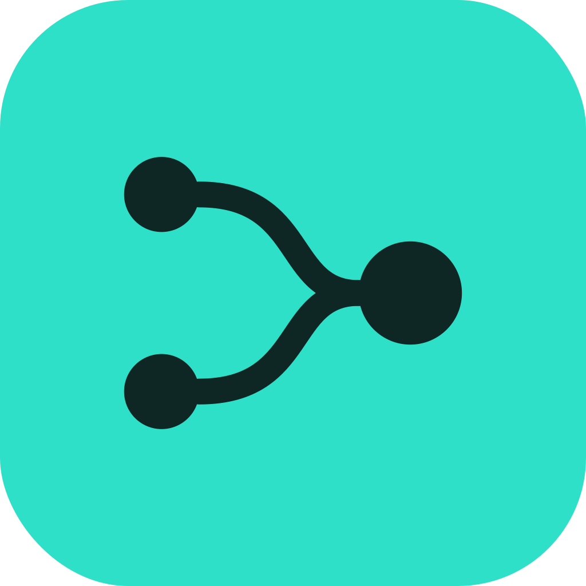
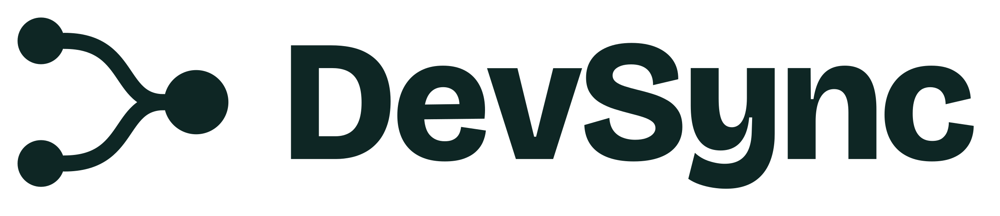
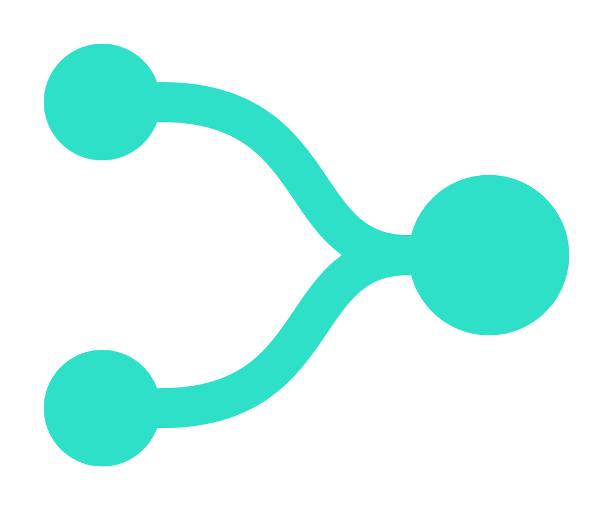
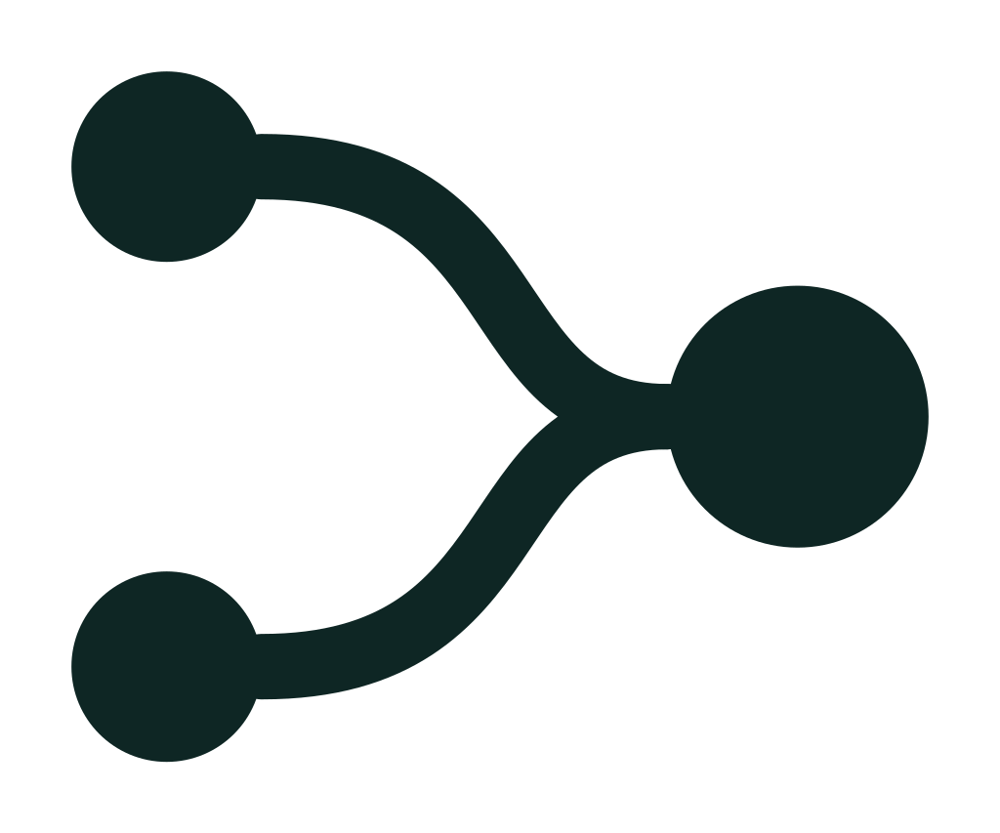
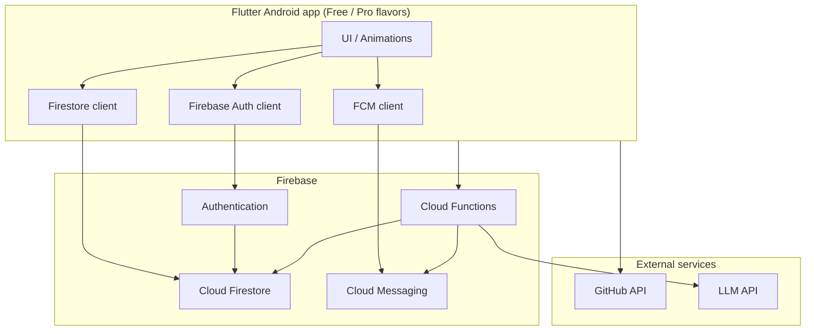

<p align="center">
  
</p>

<p align="center">
  
</p>

<h1 align="center">DevSync</h1>

<p align="center"><strong>AI-Powered Developer Collaboration Platform</strong></p>

<p align="center"><em>Code with the right people.</em></p>

<p align="center">
  
  
  
  
  
</p>

DevSync is a Flutter graduation project that helps developers discover open-source projects matching their skills, interests, and GitHub activity — and helps maintainers find relevant collaborators.

| | |
|---|---|
| 🏷️ **Project** | DevSync: Secure AI Project Collaborator |
| 🎓 **Type** | Flutter graduation project |
| 📅 **Timeline** | 16 October 2026 – 30 November 2026 |
| 📱 **Primary platform** | Android (Free and Pro flavors) |
| 🔁 **Methodology** | Agile Scrum (Jira + GitHub pull requests) |

> ⚠️ **Current repository status:** Planning and documentation are in place. Application implementation is in early setup (Flutter project scaffold). Features below are the agreed product scope unless marked as implemented.

---

## 📑 Table of contents

1. [🔍 Overview and problem statement](#1--overview-and-problem-statement)
2. [🎯 Project objectives](#2--project-objectives)
3. [✨ Core features](#3--core-features)
4. [🧰 Technology stack](#4--technology-stack)
5. [🏗️ System architecture](#5--system-architecture)
6. [👥 Project team](#6--project-team)
7. [🗓️ Timeline and methodology](#7--timeline-and-methodology)
8. [📁 Repository structure](#8--repository-structure)
9. [🚀 Getting started](#9--getting-started)
10. [🌿 Git branching and contribution workflow](#10--git-branching-and-contribution-workflow)
11. [📚 Documentation](#11--documentation)
12. [🔐 Security considerations](#12--security-considerations)
13. [🗺️ Project status and roadmap](#13--project-status-and-roadmap)

---

## 1. 🔍 Overview and problem statement

### ❗ Problem

Developers who want to contribute to open source often struggle to find projects that fit their skills and experience. Maintainers face the opposite challenge: finding contributors who are a genuine match. Existing discovery tools mostly filter by topic, language, or labels — not by a person’s real GitHub activity — and rarely provide a scored fit explanation or a built-in collaboration request flow.

### ✅ Solution

DevSync is a Flutter mobile app that:

- 🧑‍💻 Builds a developer profile from **GitHub activity** and declared **skills**
- 🤖 Uses an **LLM** (via a secure Cloud Function) to score user-to-project fit and explain why
- 👍 Lets users **like or skip** matches so prompts can be evaluated and improved
- 🤝 Supports **collaboration requests** with accept/decline workflows and **real-time FCM alerts**
- 🆓 Ships as **Free** and **Pro** Android flavors (flavor configuration only for this course delivery; not a paid store product)

Distribution for the course is an **install link** (GitHub Releases or Firebase App Distribution) for a signed, obfuscated build — not app-store publishing.

---

## 2. 🎯 Project objectives

| | Objective | Description |
|---|---|---|
| 🤖 | Working matching app | Deliver a working Android app with AI-driven developer-to-project matching |
| 🔑 | Secure authentication | Sign-in with Google and email/password via Firebase Authentication |
| 🔔 | Real-time collaboration | Collaboration requests with FCM alerts for requests and status updates |
| 🎨 | Modern UX | Smooth UI following the DevSync design system, with Flutter animations |
| 📦 | Release hygiene | Obfuscated Free and Pro release builds, plus an Android App Bundle (`.aab`) |
| 🧠 | Team learning | Every member gains hands-on experience across UI, logic, Firestore, and tests |
| 📝 | Documentation | Full technical documentation, this README, clean Git history, and a security-reviewed app |

Scope is split into **must-have** (protected through the core freeze) and **if time allows** items. Out of scope for this delivery: iOS release, app-store publishing, in-app payments, and hosting project source code inside DevSync (the app links to GitHub).

---

## 3. ✨ Core features

### ✅ Must-have (planned for core freeze — 12 November 2026)

| | Area | Features |
|---|---|---|
| 🔑 | Authentication | Google and email/password sign-in; session persistence; sign-out; account/data deletion |
| 👤 | Profile & GitHub | Import public GitHub data (languages, repositories, contributions); edit skills and bio |
| 📂 | Projects | Seed projects plus maintainer-listed projects (title, description, GitHub link, needed skills) |
| 🤖 | AI matching | Ranked feed with fit score and short reason; results cached; skills-based fallback if the model fails |
| 👍 | Feedback | Like / skip on matches to support prompt evaluation |
| 🤝 | Collaboration | Send one request per project with a message; accept / decline; status tracking (pending / accepted / declined) |
| 🔔 | Notifications | FCM alerts for requests, status changes, and project updates; permission requested at moment of use |
| 🎨 | UI / flavors | Design-system UI, key-screen animations, Free and Pro flavors (separate app ID, icon, Firebase config) |
| 🚀 | Release | Obfuscated release builds, App Bundle, install link, documentation |

### ⏳ If time allows (after core is complete — target feature freeze 26 November 2026)

- 📋 Shared **task management board** for accepted collaborations (create, assign, move tasks)
- 🔔 Task-related FCM alerts
- 📊 Prompt-quality dashboard for comparing prompt versions

### 🔮 Intentionally out of scope / future

See [🗺️ Project status and roadmap](#13--project-status-and-roadmap) for post–30 November ideas (web platform, iOS, issue-level matching, in-app chat, paid Pro, and more).

---

## 4. 🧰 Technology stack

| | Layer | Technology | Role |
|---|---|---|---|
| 📱 | Mobile app | Flutter & Dart | Cross-platform UI (Android focus for this delivery) |
| 🔑 | Auth | Firebase Authentication | Google and email/password sign-in |
| 🗄️ | Database | Cloud Firestore | Users, projects, matches cache, requests, feedback |
| 🔔 | Notifications | Firebase Cloud Messaging (FCM) | Push alerts for collaboration and updates |
| ☁️ | Backend logic | Firebase Cloud Functions | FCM triggers; secure LLM API calls (keys never in the app) |
| 🐙 | Developer data | GitHub API | Public profiles, repositories, and activity |
| 🤖 | AI matching | LLM API | Fit scores and short explanations; prompt versioning |
| 🌿 | Version control | Git & GitHub | Branches, pull requests, optional Releases for install builds |
| 📌 | Project management | Jira | Scrum board, sprints, task tracking |
| 🎨 | Design | DevSync brand system | Teal / forest palette; Bricolage Grotesque + Figtree |

<p align="center">
  
  &nbsp;&nbsp;
  
  &nbsp;&nbsp;
  
  &nbsp;&nbsp;
  
</p>

---

## 5. 🏗️ System architecture

High-level view of the planned system. Implementation will grow into this shape as features land.



### 🔄 Matching flow (planned)

1. 📥 Collect GitHub activity and declared skills into a structured profile  
2. ☁️ Send the profile and candidate projects to a Cloud Function with a versioned matching prompt  
3. 🤖 The model returns a **fit score** and a **short reason** per project  
4. 📱 The app shows a ranked feed; users **like** or **skip**  
5. 📈 Feedback and an evaluation set are used to compare prompt versions and keep the better one  

---

## 6. 👥 Project team

Everyone contributes to implementation, testing, and code reviews. Coordination roles below are accountability hats on top of rotating feature-slice ownership (UI + logic + Firestore + tests).

| Member | Coordination role | GitHub | Email |
|---|---|---|---|
| 🗂️ Donia Alhosin | Project Manager & Firebase Data Model | — | — |
| 🎨 Bishay Talaat | UI/UX Design & Branding | — | [bishayezat9@gmail.com](mailto:bishayezat9@gmail.com) |
| 🏗️ Yousef Mohy | Flutter Architecture & Release | — | [moheyy28@gmail.com](mailto:moheyy28@gmail.com) |
| 🤖 Emad Hany | AI Matching & Prompt Engineering | [@3madhani](https://github.com/3madhani) | — |
| 🛡️ Saga Maher | Quality Assurance & Security | — | [sagamaher2002@gmail.com](mailto:sagamaher2002@gmail.com) |

| Member | Focus on top of feature work |
|---|---|
| Donia Alhosin | Planning, Jira/sprints, supervisor updates, Firestore model |
| Bishay Talaat | Design system, branding assets, animation consistency, final presentation |
| Yousef Mohy | Project structure, state management, flavors, release builds, install link |
| Emad Hany | Matching prompts, evaluation set, prompt versions, AI documentation |
| Saga Maher | CI/checks, test & security checklists, evaluation harness, regression |

Deliverable leads (from the planning document) include planning (Donia), brand guide (Bishay), release builds (Yousef), AI matching (Emad), and QA/security & README coordination (Saga).

> 💡 Add missing GitHub usernames and emails as team members share them, then update this table.

---

## 7. 🗓️ Timeline and methodology

| | |
|---|---|
| 📅 **Implementation window** | 16 October 2026 – 30 November 2026 |
| 🔁 **Cadence** | Six 1-week sprints + a 6-day final window |
| 📌 **Tracking** | Jira Scrum board (To do → In progress → In review → Done), linked to GitHub |

| Period | Milestone |
|---|---|
| 🧱 W1 · 16–22 Oct | Foundation: repo/branches, Flutter flavors & theme, Firebase & data model, wireframes |
| 🔑 W2 · 23–29 Oct | Sign-in, profile, first AI-ranked match feed, like/skip |
| 🔔 W3 · 30 Oct–7 Nov | Collaboration requests + FCM end to end; animations; prompt evaluation |
| ❄️ Through 12 Nov | Core complete & tested; security review; first obfuscated build — **core freeze** |
| ✨ 13–26 Nov | Optional task board + polish, or buffer if core is behind — **feature freeze 26 Nov** |
| 🚀 29–30 Nov | Final Free/Pro builds, install link, documentation, presentation |

**✅ Definition of done:** Merged via reviewed pull request, tested by someone other than the author, and documented in the same PR where practical.

---

## 8. 📁 Repository structure

Current layout (will expand as feature modules are added under `lib/`):

```text
devsync_open_source_collaboration_app/
├── android/                 # Android host project
├── ios/                     # iOS host (not in primary delivery scope)
├── web/                     # Flutter web scaffold (not in primary delivery scope)
├── linux/ macos/ windows/   # Desktop scaffolds from Flutter create
├── lib/
│   └── main.dart            # App entry (scaffold; product features TBD)
├── test/                    # Flutter tests
├── docs/                    # Project documentation and brand assets
│   ├── DevSync-1-Project-Planning-and-Management.pdf
│   ├── DevSync-2-Literature-Review.pdf
│   ├── DevSync-3-Requirements-Gathering.pdf
│   ├── DevSync_Brand_Guidelines.pdf
│   ├── DevSync Brand Guide.html
│   └── devsync-logos/       # Logo and icon assets
├── pubspec.yaml
├── analysis_options.yaml
└── README.md
```

Planned additions during development (not present yet): Firebase config files (kept out of secrets where required), Cloud Functions project, feature folders under `lib/`, and flavor-specific Android configuration.

---

## 9. 🚀 Getting started

### ⚙️ Prerequisites

- 💙 [Flutter SDK](https://docs.flutter.dev/get-started/install) (this project targets Dart SDK `^3.12.2`)
- 🛠️ Android Studio or VS Code with Flutter/Dart plugins
- 📱 An Android emulator or physical device
- 🌿 Git

Verify your toolchain:

```bash
flutter doctor
flutter --version
```

### 📥 Clone and install dependencies

```bash
git clone <your-repository-url>
cd devsync_open_source_collaboration_app
flutter pub get
```

### ▶️ Run the app (local scaffold)

```bash
flutter run
```

Or pick a device explicitly:

```bash
flutter devices
flutter run -d <device_id>
```

### 🧪 Analyze and test

```bash
flutter analyze
flutter test
```

### ☁️ Firebase, GitHub API, and LLM setup

These backends are **required for product features** but are **not fully wired in this repository yet**. When configuring locally:

1. 🔥 Create or join the team Firebase project  
2. 📱 Add Android apps for Free and Pro flavors (separate application IDs)  
3. 📄 Place platform config files as directed by the team (never commit secrets or LLM API keys)  
4. ☁️ Deploy Cloud Functions that hold the LLM API key as a **secret**  
5. 🐙 Configure GitHub API access according to the team’s agreed approach (public data only; respect rate limits)  

Exact project IDs, package names, and credentials are shared privately within the team — they are intentionally omitted from this README.

### 🆓 Flavors and release builds (planned)

Free and Pro flavors (own app ID, icon, and Firebase config) and obfuscated release / App Bundle commands will be documented here once the flavor Gradle setup lands. Until then, use the default `flutter run` / `flutter build apk` workflow on the scaffold.

---

## 10. 🌿 Git branching and contribution workflow

Aligned with the Project Planning document:

| | Item | Rule |
|---|---|---|
| 🌳 | Branches | `main` (stable), `develop` (integration), `feature/<name>`, `fix/<name>`, `release/<version>` |
| 🔀 | Pull requests | Every change via PR with **at least one reviewer**; no direct pushes to `main` |
| 💬 | Commits | Short, clear messages starting with the Jira key (e.g. `DS-12: add match score meter`) |
| 📌 | Jira link | Jira key in branch names and commits (e.g. `feature/DS-12-match-feed`) |
| 👀 | Reviews | Author ≠ reviewer; someone other than the author tests before merge |

Suggested flow:

1. 🌱 Create a Jira-linked branch from `develop`  
2. 🛠️ Implement a feature slice (UI + logic + data + tests where applicable)  
3. 🔀 Open a pull request against `develop`  
4. ✍️ Address review feedback; merge when the definition of done is met  
5. 🏷️ Integrate to `main` for milestones / releases as agreed by the release lead  

---

## 11. 📚 Documentation

Course and project documents live under [`docs/`](docs/). Use these as the source of truth for scope and requirements.

| | Document | File |
|---|---|---|
| 📋 | Project Planning & Management | [DevSync-1-Project-Planning-and-Management.pdf](docs/DevSync-1-Project-Planning-and-Management.pdf) |
| 📖 | Literature Review | [DevSync-2-Literature-Review.pdf](docs/DevSync-2-Literature-Review.pdf) |
| 📝 | Requirements Gathering | [DevSync-3-Requirements-Gathering.pdf](docs/DevSync-3-Requirements-Gathering.pdf) |
| 🎨 | Brand Guidelines | [DevSync_Brand_Guidelines.pdf](docs/DevSync_Brand_Guidelines.pdf) |
| 🌐 | Brand Guide (HTML) | [DevSync Brand Guide.html](docs/DevSync%20Brand%20Guide.html) |

### ⚠️ Missing documentation file

A dedicated **Project Guidelines** PDF was requested for `docs/` but is **not present** in the repository under that name.

Please add it manually when available, for example:

```text
docs/DevSync-4-Project-Guidelines.pdf
```

(or the official filename required by your course). After you add it, link it in the table above.

Brand assets (logos/icons) are under [`docs/devsync-logos/`](docs/devsync-logos/).

---

## 12. 🔐 Security considerations

Security is a first-class delivery requirement (led by Saga Maher, shared by the whole team):

| | Topic | Approach |
|---|---|---|
| 🔑 | Authentication | Firebase Auth with secure token handling |
| 🛡️ | Data access | Firestore security rules so users read/write only what they should |
| 🔒 | Secrets | No API keys or tokens in the repository; LLM key stored as a Cloud Function secret |
| 🌐 | Network | HTTPS for all traffic |
| 📦 | Code protection | Obfuscation on release builds; symbol files stored safely (not in public docs) |
| ✅ | Permissions | Runtime permissions requested only when needed, with a clear explanation |
| 🔏 | Privacy | Only public GitHub data and user-declared skills; users can delete their account data |
| 📋 | Review | Security checklist completed before release |

Do **not** commit `google-services.json` variants that embed private keys beyond normal client config practice, `.env` files, service-account JSON, or LLM credentials.

---

## 13. 🗺️ Project status and roadmap

### 📊 Status (as of README authorship)

| Area | Status |
|---|---|
| 📚 Project planning & requirements docs | ✅ Available in `docs/` |
| 🎨 Brand guide and logo assets | ✅ Available in `docs/` |
| 📱 Flutter project scaffold | ✅ Present (`lib/main.dart` default template) |
| ☁️ Firebase / GitHub / LLM integration | 🧭 Planned — not implemented in-repo yet |
| ✨ Product features (auth, matching, requests, etc.) | 🧭 Planned |
| 🚀 Install-link release / App Bundle | 🧭 Planned for final delivery (30 Nov 2026) |
| 🏪 App store deployment | 🚫 Out of scope for this course delivery |

### 🏁 Near-term delivery (through 30 November 2026)

1. 🧱 Foundation, auth, profile, AI match feed, like/skip  
2. 🤝 Collaboration requests and FCM  
3. 🔐 Security review, obfuscated Free/Pro builds, documentation, presentation  
4. 📋 Optional: collaborative task board if core is complete by the freeze  

### 🔮 Future roadmap (after 30 November 2026)

From the planning and requirements documents — **not committed for this delivery**:

- 👥 Pilot with 20+ users and deeper match-quality measurement  
- 🧪 Automated prompt evaluation in CI; Remote Config / A/B for prompt versions  
- 🛡️ Firebase App Check and stronger abuse protection  
- 🌐 Web platform on the same Firebase backend  
- 🍎 iOS build  
- 💳 Real Pro plan with in-app payments  
- 🎯 Issue-level matching, skill-gap hints, maintainer search, in-app chat, endorsements  
- 🌍 Localization (e.g. Arabic RTL) and analytics dashboards  

---

## 📄 License and academic notice

This repository is a **university graduation project**. Licensing and public distribution terms should be confirmed by the team and supervisor before any open-source release beyond course requirements.

---

<p align="center">
  
</p>

<p align="center">
  <sub>DevSync · Secure AI Project Collaborator · Flutter graduation project · 2026</sub>
</p>
```
