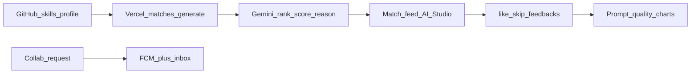

# DevSync vs acceptance text

Scorecard against **“DevSync: Secure AI Project Collaborator”** technical acceptance text.  
**Verdict:** Core product is built and demoable. Not every wording matches 100% (especially “Firebase UI Auth” and full prompt **auto-rewrite**). Document equivalents where the course text is strict.

## Bullet-by-bullet (acceptance text)

| Requirement (acceptance text) | Status | What we have |
|---|---|---|
| Platform: find collaborators; AI match on GitHub activity + skills | **DONE** | Profile GitHub scan + skills → `POST /matches/generate` → ranked deck with score/reason; diverse-skill seed for E2E |
| Prompt engineering: AI search/discovery | **DONE** | AI Studio prompt + tags → generate matches |
| Prompt **evaluation** from user feedback | **DONE** | Like/skip → `feedbacks` + prompt-quality / insights charts |
| Prompt **optimization** (refine from feedback) | **PARTIAL** | **Use best version** persists preferred `promptVersion` for the next feed; full auto-rewrite of prompt text not built |
| Auth: Firebase UI Auth, Google + Email, multiplatform | **PARTIAL** | Custom Firebase Auth (Google + Email + GitHub + OTP) on **Android** — accepted equivalent of `firebase_ui_auth` for this delivery; iOS/web Firebase not configured |
| FCM: alerts on collaboration request / project update | **DONE** (target) | `request_received` / `request_accepted` / `request_declined` / `project_updated` via Vercel `POST /notify`; inbox + live badges; open-from-push routes by type |
| Animations: Implicit + Advanced (Tween, Transition) | **DONE enough** | `AppAnimations`, Tween, `AnimatedSwitcher`, page fades; Hero not required for this delivery |

## Broader tech brief (not always in the short text)

| Criterion | Status | Gap |
|---|---|---|
| Flavors free / pro | **PASS** (target) | Gradle `productFlavors` free/pro + `FLAVOR` dart-define; Settings shows build flavor |
| Code obfuscation + Android App Bundle | **PARTIAL** | Release minify/R8 + shrink on; obfuscated AAB command in [RELEASE.md](RELEASE.md). Upload signing still debug keystore |

## Demo / defense one-liners

- **AI matching:** Yes — skills + GitHub → Gemini ranking on Vercel (API key stays off the phone).  
- **Prompt engineering:** Search + evaluate yes; “Use best version” applies preference; **auto-rewrite** of prompt text no.  
- **Auth:** Firebase Auth with Google/Email yes; **not** the `firebase_ui_auth` widget package; Android-first.  
- **FCM:** Yes for collaboration requests and project-update notify path; inbox + badges live.  
- **Animations:** Present (Tween / switcher / fades); deprioritized further Hero work.

## Still missing if graders are strict

1. **Upload signing** — replace debug `signingConfig` with a release keystore before Play upload  
2. **Prompt auto-rewrite** — generate new prompt text from best version (preference apply only today)  
3. **Optional iOS/web Firebase apps**  
4. **Two-device FCM E2E** automation under `integration_test/`  

## Bottom line

We **did** build the product described. Remaining gaps are mostly **wording/strict extras** (Firebase *UI* Auth package name, full prompt auto-rewrite, Play upload keystore) — not “no AI / no FCM / no matching.”

## Related docs

- Product / ownership: [README.md](../README.md)
- Release / flavors / AAB: [RELEASE.md](RELEASE.md)
- Claude PDF brief: [CLAUDE_PDF_GENERATION_BRIEF.md](CLAUDE_PDF_GENERATION_BRIEF.md)
